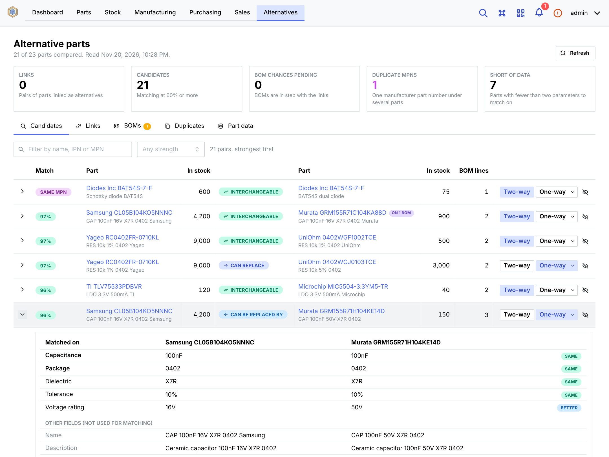
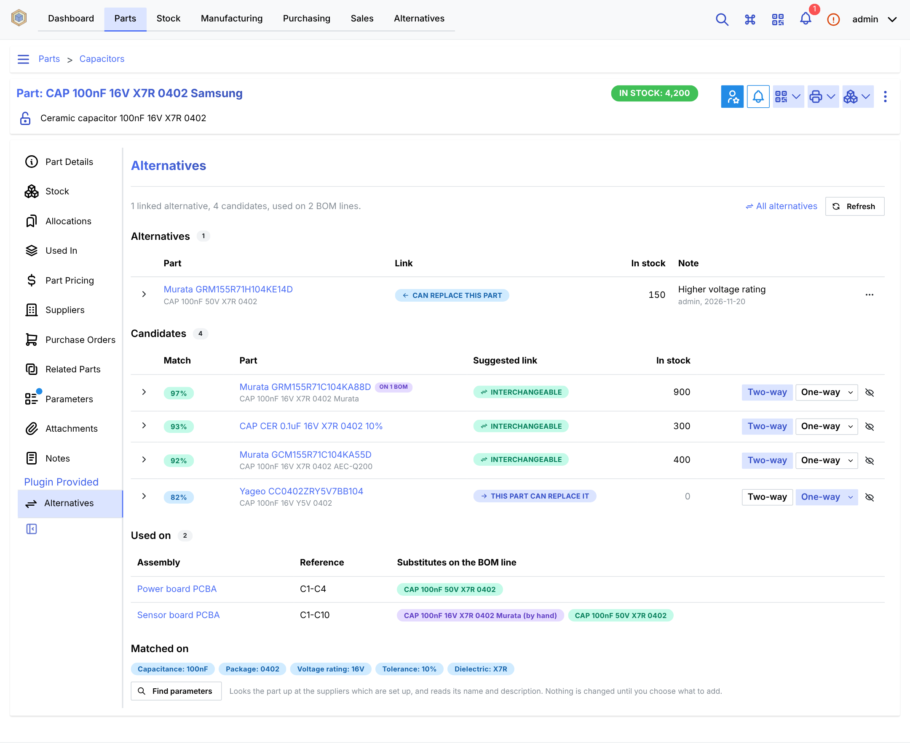

# InvenTree Alternative Parts

[](https://github.com/nemccarthy/inventree-apns/actions/workflows/ci.yaml)

Alternative part numbers for [InvenTree](https://inventree.org).

The plugin compares the parameters of your parts, ranks the parts which could
stand in for each other, and lets you **link them one-way or two-way**. Every
link is then copied to the BOM lines of its part as a substitute, so build
orders and stock checks can use the alternative on every BOM, not only the one
where somebody remembered to add it.

Built and tested against **InvenTree 1.7.3** (API 570).





## What you get

- **Alternatives** in the main navigation bar, which opens the overview page
  (`/web/plugin/apns/overview`)
- an **Alternatives** panel on every part page

The overview has five tabs:

| Tab | What it shows |
| --- | --- |
| **Candidates** | Pairs of parts which match, strongest first, with the direction in which one can replace the other. Open a row to see the two parts compared attribute by attribute. Link a pair, or hide it. |
| **Links** | Every link, with a warning where the parameters of two linked parts now disagree. |
| **BOMs** | Substitutes waiting to be added or removed, and substitutes which were set by hand on one BOM but are missing on others. |
| **Duplicates** | Manufacturer part numbers which are held under more than one part. |
| **Part data** | Parts with too few parameters to match on, and a way to fill them in. |

## One-way and two-way links

A link says that one part can be used in place of another.

- **Two-way**: the two parts are interchangeable. A 100 nF 16 V X7R 0402 from
  Samsung and the same from Murata.
- **One-way**: only one of them can replace the other. A 50 V capacitor can
  replace a 16 V one, and a 1% resistor a 5% one, but not the reverse.

Every candidate has both a **Two-way** and a **One-way** button. The one the
comparison suggests is highlighted: two-way when nothing favours either part,
one-way when one of them is better on a rating or tolerance. Either can be
used whatever the suggestion, and One-way asks which way round.

Links are not chained. If B can replace A and C can replace B, C does not
replace A unless you link those two as well.

## How parts are matched

Each part is reduced to a set of attributes, taken from its parameters:

| Attribute | Rule |
| --- | --- |
| Capacitance, resistance, inductance, frequency, package | Must be the same. A different value rules the pair out. |
| Dielectric | Should be the same; a difference lowers the match. |
| Tolerance, temperature coefficient (ppm), ESR | Lower is better. |
| Voltage, power and current rating | Higher is better. |
| Qualification (AEC-Q100/101/200, MIL, "Automotive") | A difference lowers the match and does not decide the direction: an AEC-Q200 part and an unqualified one are still offered as a pair, some points weaker, with the comparison showing which is qualified. A part which states no qualification is taken to have none. With *Hold to qualifications* turned on it is treated like a rating instead: a qualified part can replace an unqualified one (and a lower AEC-Q100 grade number a higher one), never the reverse. |
| Operating temperature range | A wider range can replace a narrower one. |
| Parameters such as *Voltage - Output*, number of pins, colour, type | Must be the same if both are numbers; otherwise a difference lowers the match. |
| Any other parameter | Compared as it is; a difference lowers the match a little. |
| RoHS, packaging, series, lifecycle, dimensions and the like | Not used for matching. Listed in the comparison under *Other fields*. |

Parameters are recognised by their name, so `Package`, `Package / Case`,
`Footprint` and `Supplier Device Package` are all the package, and
`Voltage Rating`, `Voltage - Rated` and `Rated Voltage` are all the voltage
rating, and `Qualification`, `Ratings` and `Grade` are the qualification. Values are compared whatever the notation: `100nF`, `0.1 µF` and
`100n` are the same capacitance, `0402` and `0402 (1005 Metric)` the same
package, `C0G` and `NP0` the same dielectric.

A part which is better on a "higher is better" or "lower is better" attribute
gives a **one-way** suggestion, and ranks just below a like-for-like part. If each part is better on one attribute and
worse on another, neither can replace the other and the pair is not offered.

Opening a row shows the two parts side by side: first the attributes they
are matched on, with the result for each, then every other field of both
parts (name, IPN, description, manufacturer part numbers, category and all
remaining parameters).

Parts are listed by manufacturer and MPN, with the part name below; a part
with no MPN is listed by its name.

**Match strength** runs from 0 to 100. It is the weighted share of the
compared attributes which agree, reduced when attributes are known for only
one of the two parts. Name and category count for a little.

Three more things are used:

- **Names and descriptions.** Where a parameter is missing, the value,
  package, tolerance, ratings and dielectric are read out of the name and
  description (`CAP 100nF 16V X7R 0402 10% AEC-Q200`). This counts for less than a real
  parameter and is marked *from text* in the comparison. Ratings are only read
  this way for parts which have a value: `3.3V` in the description of a
  regulator is not a rating.
- **Manufacturer part numbers.** Two parts with the same MPN are a 100% match.
- **Existing BOM substitutes.** A substitute which somebody set by hand is
  offered as a candidate at 90%, whatever its parameters say.

Parts with no parameters at all (screws, labels) are matched on their names
alone, at a reduced strength, and only if the names do not differ in a number.

Assemblies, templates, virtual parts and inactive parts are not compared
(assemblies and inactive parts can be included in the plugin settings).

## Links and BOMs

A link *B can be used in place of A* becomes a substitute B on every BOM line
whose part is A. A two-way link also puts A on every BOM line for B.

- This happens as soon as a link is made, changed or removed, and when a BOM
  line is added (see *Enable event integration* below). It can be turned off,
  in which case the BOMs only change when you press **Sync**.
- Substitutes the plugin adds are marked in their metadata. Only those are
  removed again when a link goes away. **A substitute which was added by hand
  is never changed.**
- An alternative which is inactive, or is not a component, is not added.
- InvenTree does not count substitutes as a change to the BOM, so a validated
  BOM stays validated. Locked assemblies are updated too, unless *Leave
  locked assemblies alone* is turned on.

Once the substitutes are on the BOM, everything in InvenTree which
understands substitutes uses them: build order allocation, the *can build*
figure, and plugins which read BOM substitutes.

## Filling in parameters

Matching is only as good as the parameters of your parts. **Find parameters**
(on a part, or for every part which is short of data) looks a part up and
proposes values. Nothing is stored until you choose what to add, and a
parameter the part already has is never changed.

| Source | Looked up by | Setup |
| --- | --- | --- |
| DigiKey | DigiKey part number, then manufacturer part number | Register an application at [developer.digikey.com](https://developer.digikey.com) with access to *Product Information V4*, and enter its client id and secret in the plugin settings. |
| LCSC | LCSC part number (`C12345`) held as a supplier part of LCSC or JLCPCB | Turn on *Read parameters from LCSC*. This reads the data behind the LCSC product pages, which is not a documented API and may stop working. |
| Name and description | - | Always on. |

Found values go into your existing parameter templates where one fits
(`Voltage - Rated` into `Voltage Rating`), with the value rewritten to suit
the template's unit (`0.1 µF` → `100 nF`). Where no template fits, one is
created, unless that is turned off in the settings.

> The DigiKey and LCSC lookups were written from the published request and
> response formats and tested against sample responses. They have not been
> run against the live services. If a lookup fails, the error is shown and
> nothing is changed.

## Installation

The compiled frontend is committed to this repository, so the plugin installs
straight from git - no Node tooling is needed on the server.

### 1. Install the package

Pick a git reference to install: `main` for the latest code, or a release tag
(such as `v0.1.0`) to pin a version.

**From the InvenTree web interface**

In *Admin Center → Plugins → Install Plugin*, enter:

| Field | Value |
| --- | --- |
| Package name | `inventree-apns` |
| Source URL | `git+https://github.com/nemccarthy/inventree-apns@main` |
| Version | leave empty |
| Confirm plugin installation | ticked |

**Docker, by editing `plugins.txt`**

Add this line to `plugins.txt` in the InvenTree data volume:

```
inventree-apns @ git+https://github.com/nemccarthy/inventree-apns@main
```

Either way, check that *Admin Center → Plugin Settings → Check plugins on
startup* is enabled.

**Bare metal / virtualenv**

```bash
pip install "inventree-apns @ git+https://github.com/nemccarthy/inventree-apns@main"
```

### 2. Enable it

In *Admin Center → Plugin Settings*:

1. Turn on **Enable URL integration** (the pages load their data from
   `/plugin/apns/`).
2. Turn on **Enable interface integration** (allows plugins to add pages,
   panels and navigation items).
3. Turn on **Enable event integration** if new BOM lines should pick up the
   alternatives of their part by themselves. Without it they are picked up by
   the next sync.
4. In the plugin list, find **Alternative Parts** and activate it.

### 3. Copy the plugin's files (Docker)

On a Docker stack, finish with:

```bash
docker compose run --rm inventree-server invoke update
docker compose restart inventree-server inventree-worker
```

This copies the plugin's JavaScript into InvenTree's static files. Repeat it
after every update of the plugin.

### If a page does not open

| The page shows | Cause |
| --- | --- |
| *Page Not Found - This page does not exist* | The plugin is not active, or **Enable interface integration** is off |
| *Failed to load module: .../static/plugins/apns/Apns.js* | The plugin's files have not been copied: run step 3 |
| *The Alternative Parts API was not found* | **Enable URL integration** is off |

## Settings

| Setting | Default | |
| --- | --- | --- |
| Weakest candidate to show (%) | 60 | Candidates below this strength are left out |
| Read values from names and descriptions | on | |
| Look for alternatives of assemblies | off | |
| Include inactive parts | off | As candidates, and as BOM substitutes |
| Hold to qualifications | off | Off: a different qualification only lowers the match. On: a qualified part can replace an unqualified one, never the reverse |
| Update BOMs when a link changes | on | Off: only when Sync is pressed |
| Leave locked assemblies alone | off | |
| Create parameter templates | on | When adding parameters from a supplier |
| DigiKey client id, client secret, site, currency | | Site and currency default to AU and AUD |
| Read parameters from LCSC | off | |
| Show in the navigation bar, Show on part pages | on | |

## Permissions

| To | A user needs |
| --- | --- |
| See candidates, links and pending changes | *view* on Parts |
| Link, unlink and hide candidates | *change* on Parts |
| Change BOM substitutes (sync) | *change* on Bill of Materials |
| Add parameters | *change* on Parts |

A user who may change parts but not BOMs can still make a link. The BOMs then
wait for somebody who may sync them.

## Where the data is kept

The plugin has no database tables of its own.

- A link is stored in the metadata of the part it is made on, under the key
  `apns`:
  `{"apns": {"alternates": [{"part": 45, "two_way": true, "note": "", "by": "nate", "at": "2026-11-20T10:00:00+00:00"}]}}`.
  `alternates` lists the parts which can be used in place of this one.
- A hidden candidate is stored the same way, under `dismissed`, on the part
  with the lower id.
- A substitute the plugin added to a BOM line carries
  `{"apns": {"managed": true}}` in its metadata.

Uninstalling the plugin leaves the BOM substitutes in place.

## API

All endpoints are below `/plugin/apns/` and accept token authentication.

| | |
| --- | --- |
| `GET overview/` | Links, ranked candidates, duplicates, pending BOM changes, parts short of data |
| `GET part/<id>/` | The same for one part. `?fresh=1` re-reads the parts |
| `GET links/` | Every link |
| `POST links/` | `{"part": 12, "alternate": 34, "two_way": true, "note": ""}`: 34 can be used in place of 12. Replaces any link between the two |
| `DELETE links/` | `{"part": 12, "alternate": 34}` |
| `POST dismiss/` | `{"part": 12, "other": 34, "dismissed": true}` |
| `GET sync/` | What a sync would add and remove |
| `POST sync/` | Do it. `{"parts": [12]}` limits it to BOM lines for those parts |
| `POST enrich/` | `{"part": 12}` proposes parameters; add `"apply": true` to store them, `"only": ["Capacitance"]` to store some, `"sources": ["digikey", "lcsc", "description"]` to choose where to look |

## Limits

- Links apply to every BOM. There is no way to exclude one BOM line from a
  link, other than removing the substitute by hand after each sync.
- Matching needs parameters. A part with only a manufacturer part number and
  a bare name will not be matched to anything until its parameters are filled
  in.
- The attribute rules are built for passives and simple semiconductors. For
  anything else the match strength is a hint about which parts to look at,
  not a statement that they are interchangeable: check the comparison before
  linking.
- A part with a value (capacitance, resistance, inductance, frequency) is
  only compared with parts of the same value. A part without one is compared
  with the parts in its own category (up to 400 for the overview) and with
  parts which share an uncommon word in their names. Two parts with no value,
  in different categories and with unrelated names are never compared.
- Part data is read at most once a minute, so a candidate list can lag a
  parameter change by up to a minute. **Refresh** re-reads it.

## Development

```bash
# The matching, links and parameter mapping are plain Python, with their own tests
pip install pytest
pytest

# The frontend (React + Mantine, built with Vite)
cd frontend
npm ci
npm run build        # writes inventree_apns/static - commit the result
```

| | |
| --- | --- |
| `inventree_apns/parse.py` | Reads values, packages and dielectrics out of text |
| `inventree_apns/matching.py` | Attributes, comparison, strength and ranking. No Django or InvenTree imports |
| `inventree_apns/links.py` | One-way and two-way links, and the substitutes they lead to |
| `inventree_apns/store.py` | Reads and writes the links in part metadata |
| `inventree_apns/loader.py` | Reads parts, parameters and BOM lines from InvenTree |
| `inventree_apns/sync.py` | Adds and removes BOM substitutes |
| `inventree_apns/enrich.py` | DigiKey, LCSC and description sources; maps values to parameter templates |
| `inventree_apns/serialize.py`, `views.py` | The API |
| `inventree_apns/core.py` | The plugin class: settings, URLs, events and interface |
| `frontend/src/` | The overview page and the part panel |
| `dev/seed_demo.py` | Fills a throwaway InvenTree with the demo data used in the screenshots |
| `dev/integration_check.py` | Checks candidates, links, BOM sync, parameters and permissions against that demo data |

To live-reload the frontend against an InvenTree development server, add this
to InvenTree's `config.yaml` and run `npm run dev` in `frontend/`:

```yaml
plugin_dev:
  slug: 'apns'
  host: 'http://localhost:5174'
```

## Releasing

1. Set the new version in `inventree_apns/__init__.py` (`PLUGIN_VERSION`) and
   `frontend/package.json`, and add an entry to `CHANGELOG.md`. Make sure the
   committed frontend build is current (CI on `main` is green).
2. Commit, then tag and push:

   ```bash
   git tag v0.2.0
   git push origin main v0.2.0
   ```

The release workflow checks that the tag matches `PLUGIN_VERSION`, builds the
plugin and attaches the wheel to a GitHub release.

## License

MIT - see [LICENSE](LICENSE).
